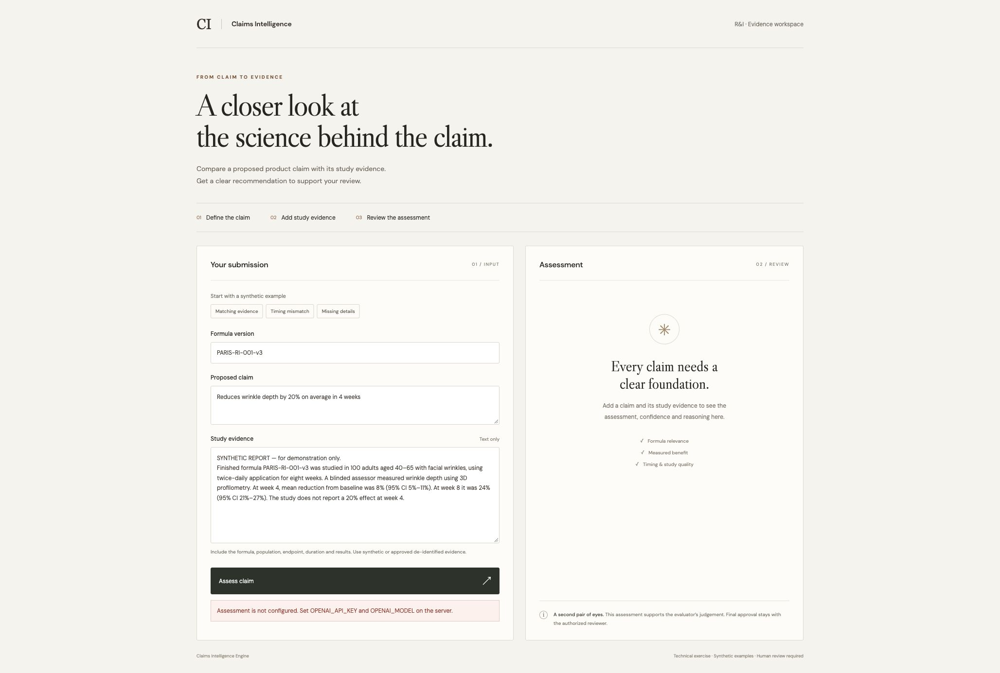

# Verification notes

Checked locally on 4 November 2026 with Node 22.23.1 and PostgreSQL 17 in Docker.

| Check | Result |
|---|---|
| Prisma client generation | Passed |
| Migration against PostgreSQL | Passed |
| TypeScript backend and Vite production build | Passed |
| HTTP/service tests | 17 passed |
| React form tests | 3 passed |
| Real PostgreSQL integration tests | 2 passed |
| Runtime dependency audit | No known vulnerabilities reported after patched transitive overrides |
| Browser → Vite proxy → running NestJS API | Confirmed; missing provider settings displayed as a clear error |
| Real OpenAI request | Not run; no API key/model configured |
| Scientific accuracy / calibrated confidence | Not evaluated |

The PostgreSQL tests use a controlled model response. They verify persistence and transaction rollback, not model quality. The React tests cover result rendering, API errors, pending state and clearing stale results.

The browser was checked using the actual local development servers. The screenshot below shows the real missing-configuration response; it is deliberately not presented as a successful AI assessment.

Before presenting a live AI demonstration, configure the provider and submit the synthetic examples. Review the reasoning against the study details, including numerical wording, timepoints and missing information. Before real-world use, obtain expert review and implement the pilot safeguards described in the proposal.
