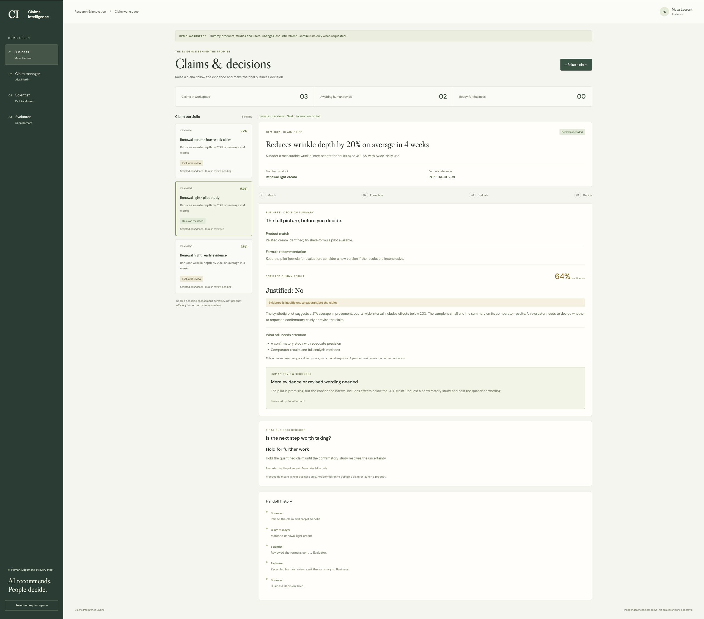

# Verification notes

Updated 6 November 2026. Checked with Node 22 and PostgreSQL 17 in Docker.

| Check | Result |
|---|---|
| Backend TypeScript and frontend production builds | Passed |
| Gemini HTTP/service tests | 19 passed |
| React/workflow tests | 12 passed |
| PostgreSQL integration tests | 2 passed |
| Existing schema migration | No pending changes; existing data preserved |
| Browser dummy walkthrough | Evaluator conclusion reached Business; final hold decision recorded |
| Browser → Vite proxy → running API | Missing Gemini configuration correctly reported; previous result cleared |
| Live Gemini call | Not run: no Gemini key/model configured in this checkout |
| Scientific accuracy / calibrated confidence | Not evaluated |

Tests control Gemini HTTP responses; they do not establish real provider availability or scientific accuracy. They verify the REST request shape, key header, structured response parsing, blocks/truncation/errors, confidence bounds, persistence and rollback. Frontend checks include all four handoffs, a new formula proposal, required human notes, no confidence-based bypass, live-vs-dummy result labels and stale-result clearing.

Dummy workflow changes are memory-only and reset on refresh. Live assessment records are saved to PostgreSQL, but reviewer and Business decisions are not yet server-backed.

## Evaluator demo

The middle-confidence case uses a scripted 64% result. The evaluator records a reasoned request for more evidence.

## Business summary

After sign-off, Business receives the evaluator's conclusion and can record a final decision. The screenshot shows a dummy hold decision, not an automatic AI approval.

